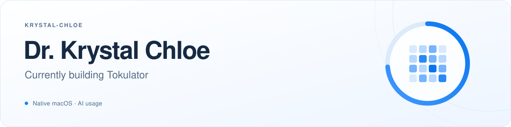

 

### Featured project

## [Tokulator](https://github.com/Krystal-Chloe/Tokulator)

A native macOS companion for AI usage — from a quick look in the menu bar to a closer view of your history.

See **Codex quota**, explore **daily trends and a usage calendar**, or keep a **transparent Mini** above your windows. Add retained local usage from **Claude Code** and **Gemini CLI** alongside Codex.

**[Explore Tokulator →](https://github.com/Krystal-Chloe/Tokulator)** &nbsp; · &nbsp; **[Download for Mac](https://github.com/Krystal-Chloe/Tokulator/releases/latest)** &nbsp; · &nbsp; [Release notes](https://github.com/Krystal-Chloe/Tokulator/releases)

macOS 14+ · Apple silicon · Free preview

 

Demo desktop and synthetic app values. Wallpaper credit and data-source details are available in the project.

 

---

Have feedback on Tokulator? [Open an issue](https://github.com/Krystal-Chloe/Tokulator/issues). Please leave private account details and usage logs out of reports.
